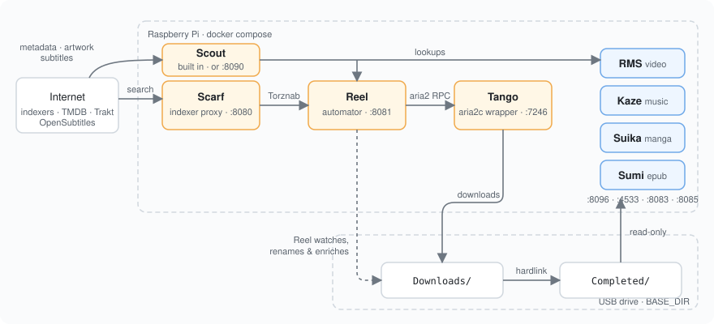

<p align="center">
  
</p>

<h1 align="center">MangoStack</h1>

<p align="center">
  A self-hosted media stack that fits on a Raspberry Pi.<br>
  A family of small single-purpose services, one <code>docker-compose.yaml</code>.
</p>

<p align="center">
  <a href="LICENSE"></a>
  
  
</p>

A self-hosted media stack for a Raspberry Pi (ARM64), built almost entirely
from a family of small, single-purpose services I wrote myself. MangoStack is
just the glue: a `docker-compose.yaml` that wires those services together
plus a tiny homepage.

## How it fits together

<p align="center"></p>

Reel asks Scarf for releases, hands the magnet to the aria2c inside Tango,
waits for it under `Downloads/`, then renames, enriches and hardlinks the
result into `Completed/`, where the four readers pick it up. Dashboarr (not
drawn) is a static homepage with a tile per service.

If you have ever looked at the *arr stack and thought "this is too much for
my Pi", MangoStack is the lightweight alternative I run on mine.

## Why MangoStack

The whole stack runs comfortably on a Raspberry Pi 3B. `docker stats` from a
live deployment, with the configs shipped in this repo (Scarf with cron jobs
off and a 32 MB cache, RMS with transcoding off, all services idle; Kaze,
Sumi and Parasol were not running when this was taken):

```
CONTAINER                CPU %   MEM USAGE / LIMIT
rms                      0.00%   37.55 MiB / 128 MiB
reel                     0.00%   15.95 MiB /  64 MiB
tango                    0.01%   25.92 MiB / 192 MiB
suika                    0.00%   10.01 MiB / 192 MiB
scarf                    0.00%   10.76 MiB /  64 MiB
dashboarr                0.00%    1.55 MiB /   8 MiB
                                 ────────
                                 ~102 MiB total RSS, idle CPU
```

Most services have optional features (caches, background jobs, web UIs,
transcoding) that change these numbers; each app's README says which. For
comparison, a typical Sonarr + Radarr + Prowlarr + Jellyfin install on
the same hardware easily uses an order of magnitude more memory and is
noticeably slower at every interaction.

## What it isn't

These services are built for *efficiency*, not for being a hardened public
endpoint. **Do not expose any of them directly to the internet.** If you
need to reach the stack from outside your LAN, put it behind a private
overlay or tunnel:

- [Tailscale](https://tailscale.com/) — easiest, zero-config WireGuard mesh
- Plain [WireGuard](https://www.wireguard.com/) — if you prefer to run your own
- An SSH tunnel or a reverse proxy with authentication, on a network you trust

The threat model of every service in this repo assumes a trusted LAN.

## What is in the stack

| Service       | Role                              | Equivalent to                          | Project |
|---------------|-----------------------------------|----------------------------------------|---------|
| **Dashboarr** | Static homepage with service tiles | Homepage, Homarr, Heimdall            | [pixelotes/dashboarr](https://github.com/pixelotes/dashboarr); link list lives in [`./dashboarr/services.json`](dashboarr/services.json) |
| **Tango**     | Web UI and friendlier REST API around `aria2c`; adds automatic tracker injection and per-torrent download paths on top of aria2's JSON-RPC endpoint — very small footprint | qBittorrent, Transmission, Deluge | [pixelotes/tango](https://github.com/pixelotes/tango) |
| **Scarf**     | Indexer proxy / aggregator         | Prowlarr, Jackett                     | [pixelotes/scarf](https://github.com/pixelotes/scarf) |
| **Reel**      | Movie & TV automator with a configurable post-download pipeline (metadata, posters, subtitles, renaming…) | Sonarr + Radarr, Flexget | [pixelotes/reel](https://github.com/pixelotes/reel) |
| **RMS**       | Raspberry Media Server — lightweight media server with built-in subtitle support; ships its own web client and speaks enough of the Jellyfin API to be used from the official [Jellyfin clients](https://jellyfin.org/clients/), [Streamyfin](https://streamyfin.app/) or the [Jellyfin for Kodi](https://github.com/jellyfin/jellyfin-kodi) plugin | Jellyfin, Emby, Plex | [pixelotes/rms](https://github.com/pixelotes/rms) |
| **Suika**     | Manga reader                       | Komga, Kavita                         | [pixelotes/suika](https://github.com/pixelotes/suika) |
| **Kaze**      | Minimal Subsonic-compatible music server (filesystem-first, no DB) | Subsonic, Airsonic, Navidrome | [pixelotes/kaze](https://github.com/pixelotes/kaze) |
| **Sumi**      | Minimal EPUB reader (filesystem-first, no DB; bookmarks in localStorage) | Calibre Web, Kavita | [pixelotes/sumi](https://github.com/pixelotes/sumi) |
| **Parasol**   | Optional. Browserless Cloudflare challenge solver for Scarf's protected indexers; speaks FlareSolverr's API and caches the clearance cookie per site | FlareSolverr, Byparr | [pixelotes/parasol](https://github.com/pixelotes/parasol) |

### Mix and match

Nothing in MangoStack is hard-wired to the bundled services:

- **Reel** speaks the standard Torznab/Newznab protocol, so it works just as
  well with Jackett or Prowlarr instead of Scarf, and it can drive
  qBittorrent, Transmission or any other client in place of Tango.
- **Tango** is a thin web-UI wrapper around `aria2c`. If you would rather
  use qBittorrent or Transmission, drop Tango and point Reel at the
  replacement.
- Don't need a piece? Comment its block out in `docker-compose.yaml` — the
  rest of the stack keeps running. Common cuts: drop **Kaze** if you
  don't stream music, drop **Suika** if you don't read manga.
- **Parasol** is off by default. A few public indexers (EZTV, Uindex,
  Tokyo Toshokan, BTdirectory) sit behind Cloudflare challenges; enable the
  `parasol` profile and set `FLARESOLVERR_URL=http://parasol:8191` to reach
  them. It replaces FlareSolverr at a fraction of the memory (a few MB idle,
  ~200 MB after solving, versus ~700 MB). If you already run FlareSolverr on
  a bigger machine, point `FLARESOLVERR_URL` there instead.

## Repository layout

```
.
├── docker-compose.yaml   # the whole stack, with relative bind mounts
├── .env.example          # template for environment variables
├── dashboarr/            # link tiles for the homepage (services.json)
├── tango/                # Tango config + (runtime) session/data
├── reel/                 # Reel config + (runtime) data
├── rms/                  # RMS config (config.yml is tracked, rest ignored)
├── suika/                # Suika config (config.yml is tracked, rest ignored)
├── kaze/                 # Kaze config (config.yml is tracked, rest ignored)
├── sumi/                 # Sumi config (config.yml is tracked, rest ignored)
├── scarf/                # Scarf indexer definitions + (runtime) data
├── assets/               # logo + architecture diagram (SVG)
├── docs/                 # extra notes
├── bootstrap.sh          # interactive setup wizard
└── README.md
```

Configs live in the repo and are bind-mounted directly into the containers via
relative paths in `docker-compose.yaml`. Runtime state (sqlite DBs, caches,
processing-state files) ends up in the same subdirectories at runtime and is
covered by [`.gitignore`](.gitignore). Only the bulk media library
(`BASE_DIR` / `MEDIA_DIR`) lives outside the repo.

## Requirements

- A Raspberry Pi (or any ARM64 host) running Docker Engine with the
  `compose` plugin.
- A place to put media. The defaults assume a USB drive mounted at
  `/media/usb`, but any path works — adjust `.env` accordingly.
- Memory cgroups enabled, so the per-container memory limits in
  `docker-compose.yaml` take effect. On Raspberry Pi OS add
  `cgroup_enable=memory cgroup_memory=1` to `/boot/firmware/cmdline.txt`
  and reboot.

## Quick start

```bash
git clone https://github.com/pixelotes/MangoStack.git
cd MangoStack

# Interactive setup: prompts for password, paths, languages and which
# services to enable; generates .env and fills in JWT secrets / passwords.
./bootstrap.sh

# Paste API keys (TMDB, Trakt, OpenSubtitles, ...) into the files the
# script lists at the end — they come from your password manager.

# Bring the stack up
docker compose up -d
```

Once running, the homepage is on <http://raspberrypi:3000> (replace
`raspberrypi` with your host name or IP).

### Manual setup (without the wizard)

If you'd rather edit by hand:

```bash
cp .env.example .env
$EDITOR .env                            # paths, secrets, COMPOSE_PROFILES

# Fill in everything marked REPLACE_WITH_... in the per-service configs
$EDITOR reel/config.yml                  # SCARF_API_KEY, API keys
$EDITOR rms/config.yml
$EDITOR suika/config.yml

# Optional: customise the homepage tiles
$EDITOR dashboarr/services.json

docker compose up -d
```

Generate any JWT secret with `openssl rand -hex 48`.

## Per-service configuration

The shipped configs are exactly what I run on my Pi, with credentials replaced
by `REPLACE_WITH_...` placeholders. Edit them in place — there is no separate
copy step.

| Service   | Config file                              | Notes |
|-----------|------------------------------------------|-------|
| Tango     | [`tango/config.yaml`](tango/config.yaml) | tuned for Raspberry Pi 3B |
| Reel      | [`reel/config.yml`](reel/config.yml) | talks to Tango's REST API (`torrent_client.type: storm`); needs TMDB, Trakt, OpenSubtitles keys and `SCARF_API_KEY` |
| RMS       | [`rms/config.yml`](rms/config.yml)   | needs TMDB and OpenSubtitles keys |
| Suika     | [`suika/config.yml`](suika/config.yml) | just UI password + JWT |
| Kaze      | [`kaze/config.yml`](kaze/config.yml) | just UI password + JWT |
| Sumi      | [`sumi/config.yml`](sumi/config.yml) | just UI password + JWT |
| Scarf     | [`scarf/definitions/`](scarf/definitions) | 4 example indexer definitions, all shipped with `enabled: "false"` — turn on the ones you want from the Scarf UI or by editing the file; password, JWT and the Torznab API key (`SCARF_API_KEY`, shared with Reel) come from `.env` |
| Dashboarr | [`dashboarr/services.json`](dashboarr/services.json) | edit hostname and Trakt links |

For deeper tuning, refer to the upstream documentation:

- Tango → <https://github.com/pixelotes/tango>
- Scarf → <https://github.com/pixelotes/scarf>
- Reel  → <https://github.com/pixelotes/reel>
- RMS  → <https://github.com/pixelotes/rms>
- Suika  → <https://github.com/pixelotes/suika>
- Kaze   → <https://github.com/pixelotes/kaze>
- Sumi   → <https://github.com/pixelotes/sumi>
- Parasol → <https://github.com/pixelotes/parasol>
- Dashboarr → <https://github.com/pixelotes/dashboarr>

## License

[MIT](LICENSE).
